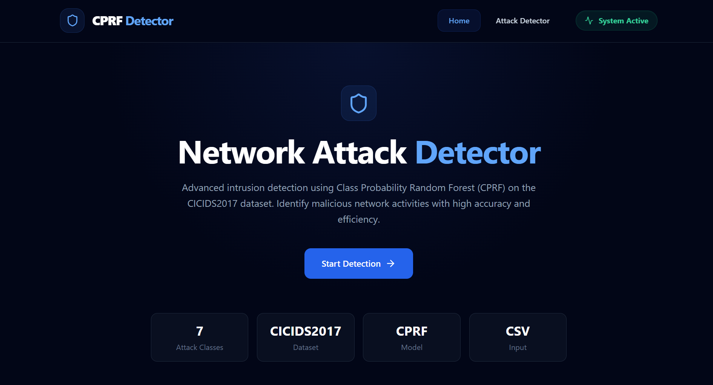
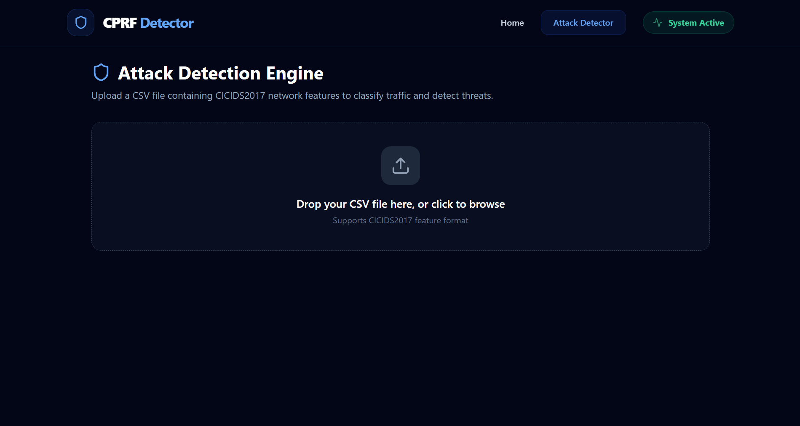
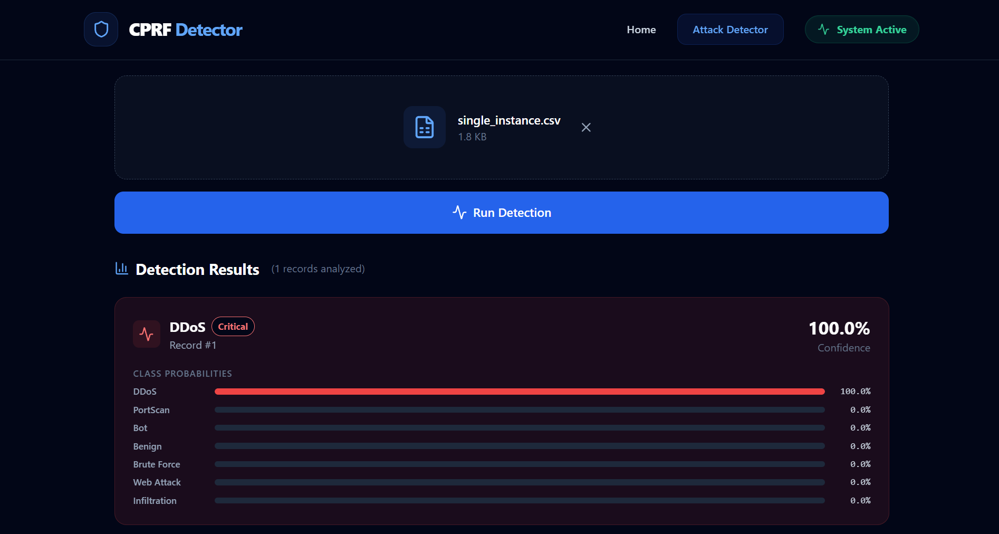

<h1 align="center">
  🛡️ CPRF Network Attack Detector
</h1>

<p align="center">
  <strong>Class Probability Random Forest — Intrusion Detection System</strong>
  <br />
  Real‑time network traffic classification powered by machine learning on the CICIDS2017 dataset.
</p>

<p align="center">
  
  
  
  
  
  

---

## 📋 Table of Contents

- [Project Description](#-project-description)
- [Features](#-features)
- [Tech Stack](#-tech-stack)
- [Architecture Overview](#-architecture-overview)
- [Screenshots](#-screenshots)
- [Installation](#-installation)
- [Environment Variables](#-environment-variables)
- [Running the Project](#-running-the-project)
- [Folder Structure](#-folder-structure)
- [API Endpoints](#-api-endpoints)
- [Usage Guide](#-usage-guide)
- [Future Improvements](#-future-improvements)
- [Author](#-author)

---

## 📖 Project Description

**CPRF Network Attack Detector** is a full‑stack intrusion detection system that classifies network traffic into seven categories using a **Class Probability Random Forest (CPRF)** model trained on the **CICIDS2017** benchmark dataset.

Users upload a CSV file containing network flow features; the backend runs inference through a pre‑trained Random Forest classifier and returns per‑record predictions with confidence scores and class‑probability breakdowns. Results are displayed in a responsive dashboard with a light/dark theme toggle.

---

## ✨ Features

| Feature                        | Description                                                                                                        |
| ------------------------------ | ------------------------------------------------------------------------------------------------------------------ |
| **CSV Upload & Drag‑and‑Drop** | Upload CICIDS2017‑formatted CSV files via click or drag‑and‑drop                                                   |
| **7‑Class Classification**     | Detects **Benign**, **Bot**, **Brute Force**, **DDoS**, **Infiltration**, **PortScan**, and **Web Attack** traffic |
| **Confidence Scoring**         | Each prediction includes a confidence percentage and full class‑probability distribution                           |
| **Visual Probability Bars**    | Per‑class probability bars for interpretable, transparent results                                                  |
| **Threat Level Indicators**    | Color‑coded badges: Safe (🟢), Warning (🟡), Critical (🔴)                                                         |
| **Summary Statistics**         | Aggregate attack counts for a quick overview of uploaded traffic                                                   |
| **Light & Dark Theme**         | Toggle between themes from the navigation bar                                                                     |
| **Responsive UI**              | Adaptive navigation and layouts built with Tailwind CSS and Lucide icons                                           |
| **Reduced-Motion Support**     | Home-page animations respect the visitor's reduced-motion preference                                               |
| **REST API**                   | Simple `POST /predict` endpoint for programmatic integration                                                       |

---

## 🛠️ Tech Stack

| Layer                | Technology                                                          |
| -------------------- | ------------------------------------------------------------------- |
| **Frontend**         | React 19, React Router v7, Tailwind CSS 3.4, Vite 8.1, Lucide React |
| **Backend**          | FastAPI (Python 3.13+), Uvicorn, python‑multipart                   |
| **Machine Learning** | scikit‑learn (Random Forest), pandas, joblib                        |
| **Dataset**          | CICIDS2017 (Canadian Institute for Cybersecurity)                   |

---

## 🏗️ Architecture Overview

```
┌──────────────┐     CSV Upload      ┌──────────────┐     ┌──────────────────┐
│   React SPA  │ ──────────────────►  │  FastAPI      │────►│  Random Forest   │
│  (Vite +     │                     │  Backend      │     │  Classifier      │
│   Tailwind)  │◄──────────────────── │  (Python)     │◄────│  (joblib)        │
└──────────────┘    Predictions +     └──────────────┘     └──────────────────┘
                    Probabilities
```

1. The user uploads a CSV file through the React UI (or directly via `POST /predict`).
2. The FastAPI server reads the CSV with pandas and passes it to the pre‑loaded Random Forest model.
3. The model returns a predicted class and per‑class probabilities for every row.
4. Results are sent back as JSON and rendered as interactive result cards.

---

## 📸 Screenshots

### Home Page



### Attack Detection Engine (Upload)



### Detection Results



---

## 🔧 Installation

### Prerequisites

- **Node.js** ≥ 18 and **npm** ≥ 9
- **Python** ≥ 3.13 and **pip** / **uv**
- **Git**

### 1️⃣ Clone the Repository

```bash
git clone https://github.com/harysri/network-attack-detection.git
cd network-attack-detection
```

### 2️⃣ Frontend Setup

```bash
cd client
npm install
```

### 3️⃣ Backend Setup

```bash
cd server
python -m venv .venv
.venv\Scripts\activate      # Windows
# source .venv/bin/activate  # macOS / Linux
pip install -r requirements.txt   # or: uv sync
```

> If using `uv`, the dependencies are defined in `pyproject.toml` — simply run `uv sync` inside `server/`.

---

## 🌍 Environment Variables

Create a `.env` file inside the `server/` directory (optional — defaults work out of the box):

```env
# Server
HOST=0.0.0.0
PORT=8000

# CORS (comma-separated origins for production)
CORS_ORIGINS=http://localhost:5173,http://localhost:3000
```

---

## 🚀 Running the Project

### Start the Backend (API Server)

```bash
cd server
.venv\Scripts\activate
uvicorn main:app --reload --port 8000
```

The API will be available at **http://localhost:8000** and the interactive docs at **http://localhost:8000/docs**.

### Start the Frontend (Dev Server)

```bash
cd client
npm run dev
```

The app will be available at **http://localhost:5173**.

---

## 📁 Folder Structure

```
network-attack-detection/
│
├── client/                          # React frontend
│   ├── public/
│   │   ├── favicon.svg
│   │   └── icons.svg
│   ├── src/
│   │   ├── assets/
│   │   │   ├── hero.png
│   │   │   ├── react.svg
│   │   │   └── vite.svg
│   │   ├── context/
│   │   │   ├── ThemeContext.jsx
│   │   │   └── theme-context.js
│   │   ├── Componets/
│   │   │   ├── Footer.jsx
│   │   │   └── Navbar.jsx
│   │   ├── Pages/
│   │   │   ├── Attack_detector.jsx
│   │   │   └── Home.jsx
│   │   ├── App.css
│   │   ├── App.jsx
│   │   ├── index.css
│   │   └── main.jsx
│   ├── index.html
│   ├── package.json
│   ├── vite.config.js
│   ├── tailwind.config.js
│   ├── postcss.config.js
│   └── eslint.config.js
│
├── server/                          # FastAPI backend
│   ├── model/
│   │   └── random_forest_model.joblib
│   ├── .venv/                       # Python virtual environment
│   ├── main.py                      # FastAPI application
│   ├── pyproject.toml
│   ├── .python-version
│   └── uv.lock
│
├── screenshots/                     # README screenshots
│   ├── banner.png
│   ├── home.png
│   ├── upload.png
│   └── results.png
│
├── README.md
└── .gitignore
```

---

## 📬 API Endpoints

### `GET /health`

Returns the API health status.

**Response:**

```json
{
  "status": "ok",
  "model_loaded": "random_forest_model.joblib"
}
```

---

### `POST /predict`

Upload a CSV file for attack classification.

**Request:**

| Parameter | Type   | Location  | Description                              |
| --------- | ------ | --------- | ---------------------------------------- |
| `file`    | `file` | Form Data | CSV file with CICIDS2017 feature columns |

**Response:**

```json
{
  "predictions": [
    {
      "class": "DDoS",
      "confidence": 0.9876,
      "probabilities": {
        "Benign": 0.0012,
        "Bot": 0.0031,
        "Brute Force": 0.0028,
        "DDoS": 0.9876,
        "Infiltration": 0.0011,
        "PortScan": 0.0035,
        "Web Attack": 0.0007
      }
    }
  ]
}
```

**Error Responses:**

| Status | Meaning                                 |
| ------ | --------------------------------------- |
| `400`  | Invalid file (non‑CSV or malformed CSV) |
| `500`  | Prediction / model error                |

---

## 📊 Usage Guide

### 1. Prepare Your CSV

Your CSV must contain the same features the model was trained on (CICIDS2017 flow features). Example columns include:

`Destination Port`, `Flow Duration`, `Total Fwd Packets`, `Total Backward Packets`, `Flow Bytes/s`, etc.

> 💡 **Tip:** Download the CICIDS2017 dataset from the [official repository](https://www.unb.ca/cic/datasets/ids-2017.html) and extract a subset for testing.

### 2. Upload & Detect

1. Navigate to the **Attack Detector** page (`/detect`).
2. Drag & drop your CSV (or click to browse).
3. Click **Run Detection**.
4. Scroll through per‑record results with threat badges and probability bars.

### 3. Interpret Results

- **Confidence** — how certain the model is about the predicted class.
- **Class Probabilities** — the model's full probability distribution across all 7 classes.
- **Threat Level** — quick visual indicator:
  - 🟢 **Safe** — Benign
  - 🟡 **Warning** — Bot, Brute Force, PortScan
  - 🔴 **Critical** — DDoS, Infiltration, Web Attack

### 4. Programmatic Usage

You can also call the API directly:

```bash
curl -X POST http://localhost:8000/predict \
  -F "file=@traffic_sample.csv"
```

---

## 🔮 Future Improvements

- [ ] **User Authentication** — JWT‑based login to protect the detection endpoint
- [ ] **Model Retraining API** — Allow uploading labelled data to retrain the model
- [ ] **WebSocket Streaming** — Real‑time classification of streaming traffic
- [ ] **Batch Export** — Download results as CSV / PDF
- [ ] **Attack Visualization** — Charts for traffic patterns over time
- [ ] **Docker Compose** — One‑command setup for the entire stack
- [ ] **CI/CD Pipeline** — Automated testing and deployment with GitHub Actions
- [ ] **Model Registry** — Support multiple model versions / compare accuracy

---

## 👤 Author

**Srihari Satheeshan**

- GitHub: [@harysri](https://github.com/harysri)
- Email: sriharisatheeshan820@gmail.com

---

## 🙏 Acknowledgements

- [Canadian Institute for Cybersecurity](https://www.unb.ca/cic/) for publishing the **CICIDS2017** dataset
- [scikit-learn](https://scikit-learn.org/) — the machine learning library powering the classifier
- [FastAPI](https://fastapi.tiangolo.com/) for the high‑performance Python backend framework
- All open‑source contributors whose libraries made this project possible

---

<p align="center">
  Made with ❤️ for the cybersecurity community
</p>
